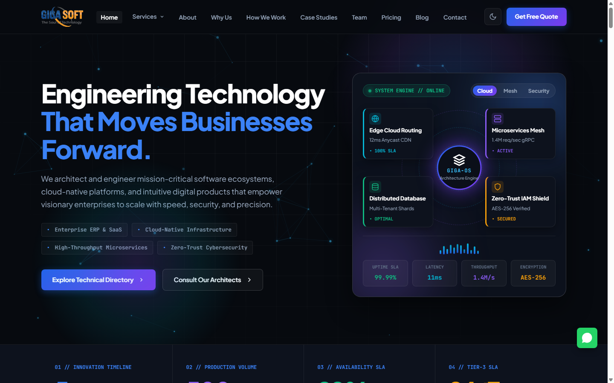
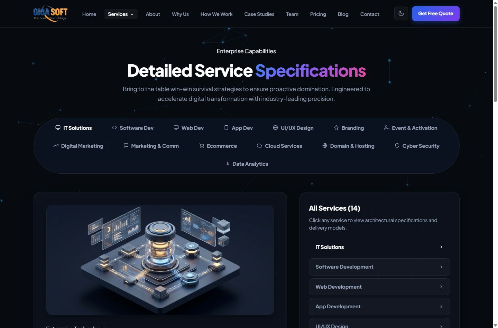
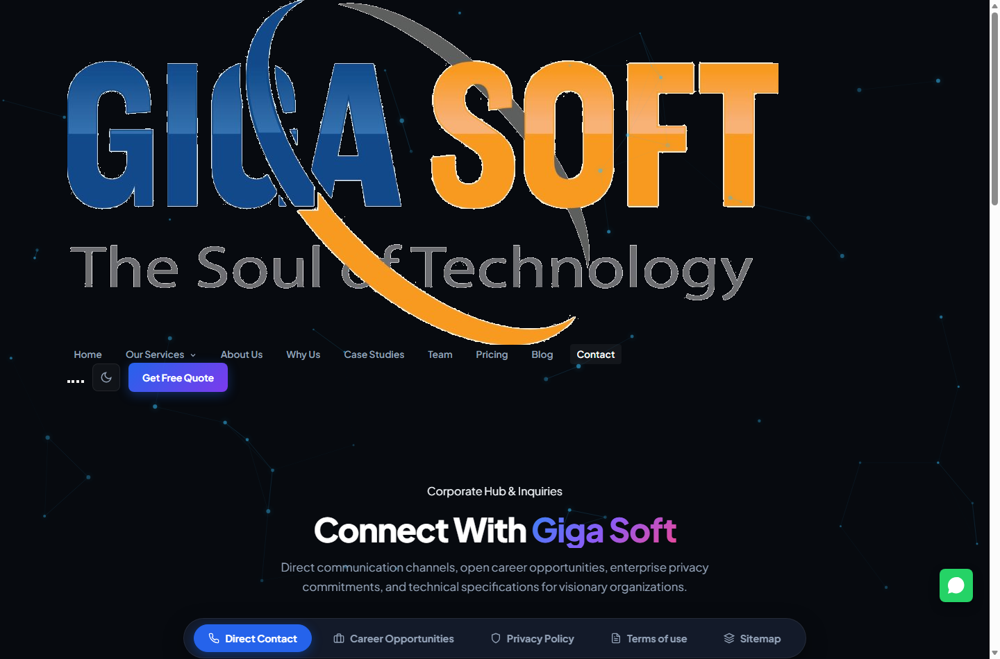
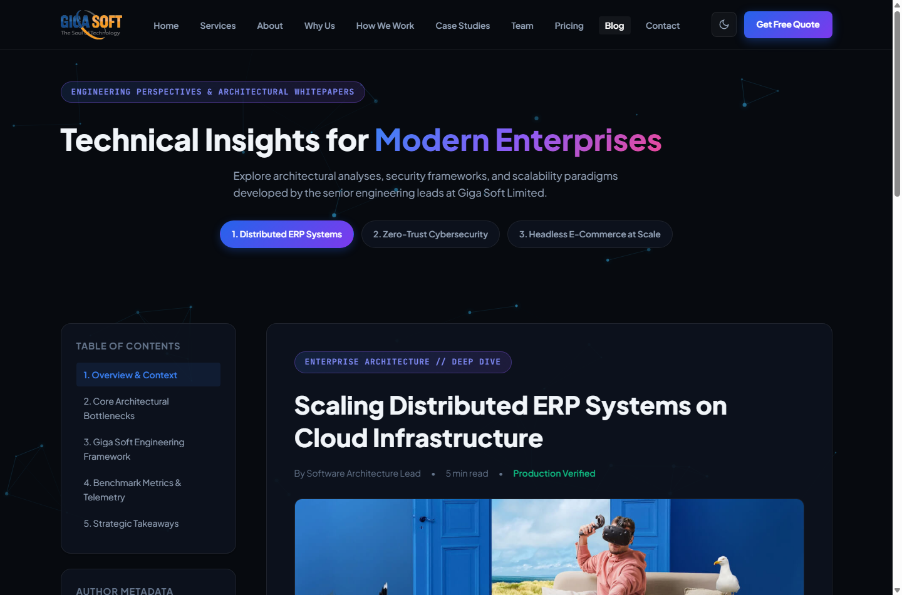
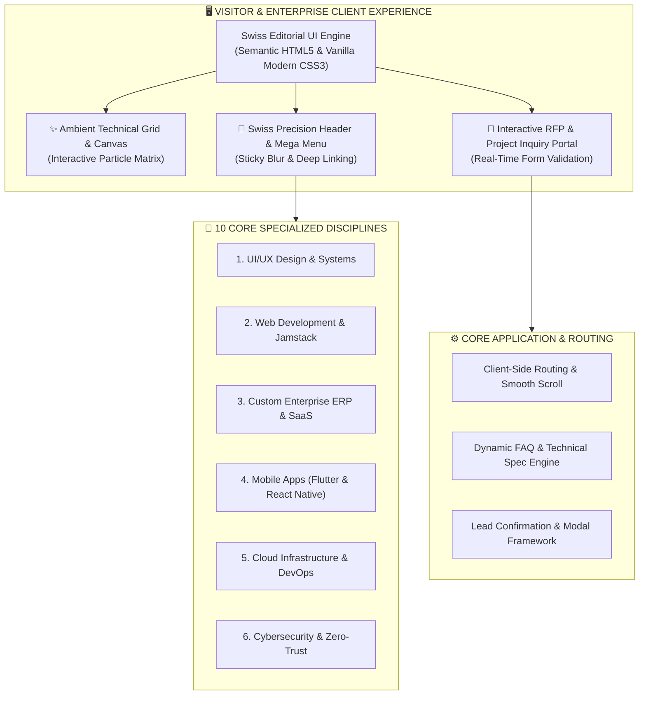

# Giga Soft Limited &mdash; The Soul of Technology

[](https://giga-soft-bd.vercel.app/)
[](https://giga-soft-bd.vercel.app/)
[](https://giga-soft-bd.vercel.app/)
[](https://giga-soft-bd.vercel.app/)
[](https://giga-soft-bd.vercel.app/contact.html)

**Innovating Software. Empowering Businesses.**

Official website and digital engineering portal for **Giga Soft Limited** &mdash; a premier enterprise software development, mobile application engineering, cloud infrastructure, and digital solutions powerhouse headquartered in Lalmatia, Dhaka, Bangladesh.

---

## 📸 Website Visual Showcase & Live User Experience

Here is the exact visual experience users encounter across the live platform at [https://giga-soft-bd.vercel.app/](https://giga-soft-bd.vercel.app/):

### 1. Enterprise Hero & Ambient Precision Canvas

*High-contrast Swiss architectural layout featuring ambient technical canvas, custom particle backdrop, prominent brand identity, and multi-tier navigation.*

---

### 2. Enterprise Software Solutions & System Architecture

*Deep-dive engineering specifications, modular cloud microservices, zero-trust cybersecurity protocols, and enterprise ERP capabilities.*

---

### 3. Corporate Headquarters & Interactive Inquiry Portal

*Direct client communication gateway with instant inquiry validation, office map, hotlines, WhatsApp integration, and executive scheduling.*

---

### 4. Technical Insights & Engineering Knowledge Base

*Editorial knowledge hub covering cloud modernization, AI automation, cybersecurity frameworks, and enterprise software best practices.*

---

## 🗺️ System Architecture & Engineering Deck



---

## 🌟 10 Core Digital Disciplines

1. **UI/UX Design** &mdash; User research, Figma wireframing, design systems, and high-fidelity interactive prototypes.
2. **Web Development** &mdash; High-speed, responsive, modern web applications built with semantic architecture and optimal Core Web Vitals.
3. **Software Development** &mdash; Custom ERPs, enterprise portals, CRM systems, and scalable SaaS platforms.
4. **App Development** &mdash; Native & cross-platform iOS/Android mobile apps engineered with Flutter and React Native.
5. **Digital Marketing** &mdash; Multi-channel performance marketing, Facebook boosting, Google search & YouTube campaigns.
6. **Marketing & Communication** &mdash; Strategic corporate PR, brand messaging, media placement & corporate reputation management.
7. **Creative Branding** &mdash; Complete visual identity, logo design, corporate brand guidelines & print collateral.
8. **Event Management & Activation** &mdash; Corporate product launches, experiential brand activations & BTL marketing.
9. **E-Commerce Solutions** &mdash; High-converting online storefronts with local Bangladeshi payment gateway integrations (bKash, Nagad, Rocket).
10. **Domain & Hosting** &mdash; High-speed NVMe cloud servers, corporate domain management, and 99.9% uptime SLA.

---

## 📂 Project Directory Structure

```
giga-soft-bd/
├── 📄 index.html                 # Production homepage with hero, metrics, services, and team
├── 📄 service-details.html       # Architectural deep-dive & service specifications
├── 📄 contact.html               # Corporate contact portal, Google map, and inquiry form
├── 📄 blog-details.html          # Technical insights, whitepapers & engineering articles
├── 📁 screenshots/               # High-resolution live capture previews for documentation
│   ├── 🖼️ preview-hero.png            # Main hero & ambient grid view
│   ├── 🖼️ preview-services-detail.png # Service architecture & engineering deck
│   ├── 🖼️ preview-contact.png         # Corporate contact portal
│   └── 🖼️ preview-blog.png            # Technical insights & article reader
├── 📁 css/                       # Modular stylesheets
│   ├── 📄 style.css              # Custom variables, design system, cards & layout
│   └── 📄 responsive.css         # Breakpoint definitions across mobile, tablet, and ultra-wide
├── 📁 js/                        # Client-side JavaScript
│   ├── 📄 main.js                # Ambient canvas animation, mobile menu, and accordions
│   └── 📄 forms.js               # Form validation and client response handlers
├── 📁 images/                    # Corporate branding, client logos, and project media
│   ├── 🖼️ giga-soft-logo.png     # Official high-resolution brand logo
│   ├── 📁 about/                 # Executive team & corporate imagery
│   ├── 📁 clients/               # Client & partner brand marks
│   └── 📁 blog/                  # Technology illustration assets
├── 📄 vercel.json                # Vercel deployment and routing configuration
└── 📄 README.md                  # Master documentation with visual screenshots
```

---

## 🚀 Local Development & Preview

### Method 1: Instant Browser Preview
1. Clone or download the repository.
2. Open `index.html` directly in any modern browser (Chrome, Edge, Firefox, Safari).

### Method 2: Live Server via Visual Studio Code
1. Open the repository in **VS Code**:
   ```bash
   code .
   ```
2. Install the **Live Server** extension if not already installed.
3. Right-click `index.html` and choose **"Open with Live Server"**.
4. The site will launch on `http://127.0.0.1:5500`.

### Method 3: Static HTTP Server (Node.js / Python)
```bash
# Using Node.js npx
npx serve .

# Or using Python 3
python -m http.server 3000
```

---

## 🏢 Corporate Headquarters & Contact

* **Organization:** Giga Soft Limited
* **Tagline:** The Soul of Technology
* **Headquarters:** House-6/14, Hasina De Palace, Block-A, Lalmatia, Dhaka-1207, Bangladesh
* **Hotline / Phone:** `+880 1778-741894` / `01778741894`
* **Email:** `gigasoftbd@gmail.com`
* **Official Website:** [https://giga-soft-bd.vercel.app/](https://giga-soft-bd.vercel.app/)
* **Parent Group:** [Giga Group of Bangladesh](https://gigagroup.com.bd/)

---

© 2020-2026 Giga Soft Limited. All Rights Reserved. Part of the Giga Group conglomerate.
